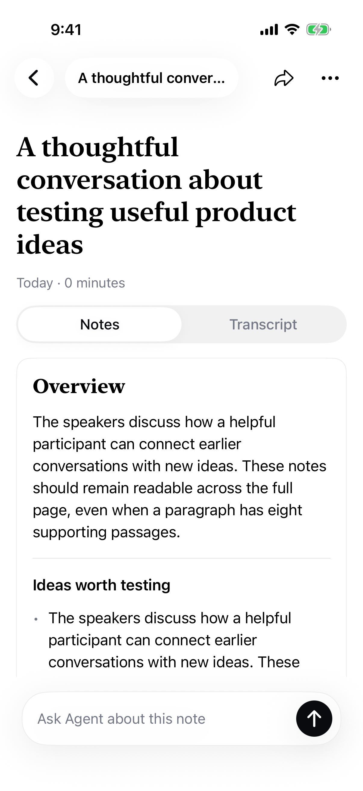

# Saved-note layout regression — September 28, 2026

The founder's first physical proactive-test recording saved successfully, but each supporting passage added a 44-point icon alongside the paragraph. Multiple sources squeezed the text and widened the entire detail page beyond the phone.

The note body now renders full-width regular-weight paragraphs and bulleted sections without document icons. Titles wrap within the content margins. Supporting transcript passages remain available through a paragraph's native context menu.

Verification: `RecordingNotesPhoneUITests/testManyPassagesKeepNotesReadable` passed on iPhone Simulator C804A6C5-EC44-4271-8E83-A224EB2D9234. A synthetic saved recording with eight passages flowed through the local notes service into the actual native view. Assertions checked paragraph width, title/paragraph horizontal bounds, absence of inline citation controls, and successful long-press passage navigation. The attached screenshot was visually inspected. Signed generic-iOS build also succeeded. No paid transcription or model calls were used. Mac context-menu test was updated but not rerun; physical-phone visual confirmation remains separate from simulator evidence.

Reproduce with `PYTHONPATH=Backend python3 Backend/companion_fixture.py /tmp/notes-layout-fixture --ui --notes`, then pass its config as `TEST_RUNNER_VOICE_MEMORY_UI_CONFIG` to `xcodebuild -scheme Phone -destination 'platform=iOS Simulator,id=C804A6C5-EC44-4271-8E83-A224EB2D9234' -only-testing:PhoneUITests/RecordingNotesPhoneUITests/testManyPassagesKeepNotesReadable test`.

