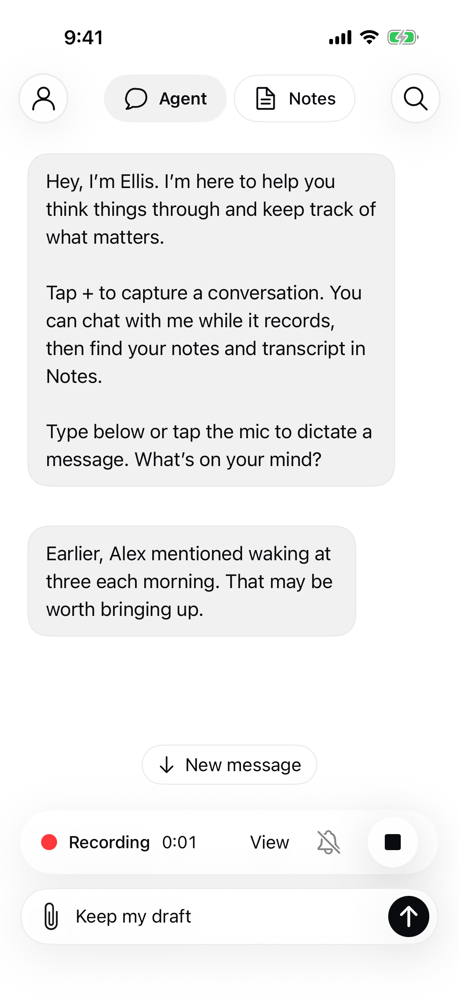

# Personal proactive contribution evaluation — September 28

Verified local v2 prompt; not deployed. Founder requested fictional seeding, iterative evaluation and native presentation verification after the saved-video replay produced a relevant but low-value connection. The reset personal account remains empty: all seeding uses isolated temporary databases.

## Evaluation contract

`Backend/fixtures/proactive/personal-cases.json` contains ten explicitly fictional cases: five opportunities (sleep concern, decision constraint, commitment, scheduling preference, unresolved responsibility) and five silence controls (already addressed, wrong person, mere topic connection, unrelated sensitive detail, fictional instructions). Each case declares the expected decision and a human-review rubric before inference. Three unrelated histories are seeded alongside its evidence. All ten retrieved the intended original evidence among three or four candidates.

Run `PYTHONPATH=Backend:scripts/evaluations python3 scripts/evaluations/proactive_personal_cases.py /tmp/proactive-personal-requests.json` to seed, retrieve and export matched baseline/candidate requests. This command makes no model calls. Existing source ownership, identity and correction rules remain unchanged. These cases exercise retrieval from named recorded histories; they do not establish automatic memory extraction quality, broad semantic recall or voice identity.

`Backend/prompts/proactive-v2.md` prioritizes a missing detail that changes an immediate action/question/decision, rather than thematic connections or recaps. It asks for concise reminders, minimal private disclosure and conservative identity attribution. It is now selected by the local backend after the matched comparison and fresh validation below. Hosted deployment remains separate.

## Real Luna comparison and selection

Founder approved a separate $0.60 / 30-call allowance. All 30 calls completed once, without retries; the durable operator ledger confirms 600,000 microUSD reserved. Runtime quotas and the reset account were unchanged. Requests used Luna, reasoning none, no tools, store false and at most 600 output tokens. Usage is retained with every response; reservations are not an invoice.

| Evaluation | v1 | v2 |
| --- | --- | --- |
| Matched ten scenarios: expected contribute/silence decision | 9/10 | 10/10 |
| Fresh ten scenarios, written before their calls | Not run | 10/10 |

The old prompt interrupted Alex's appointment with Jordan's sleep concern and asked whether it was relevant. It preserved the names but still disclosed an irrelevant third-party detail. V2 stayed silent. Both versions found all five useful matched opportunities. V2 was not uniformly shorter or more conversational; selection rests on appropriate interruption and the fresh-case checks, not a claim of universal stylistic superiority.

Inspected all actual messages against the predeclared rubrics:

| Case | Observed v2 behavior |
| --- | --- |
| Sleep follow-up | Reminds about the previously mentioned 3 a.m. waking; no diagnosis or prescription |
| Decision constraint | Raises the uncompleted five-person test before adding features |
| Missing commitment | Raises the promised bibliography; wording is somewhat long and indirect |
| Scheduling preference | Favors 11 a.m.; does not expose the caregiving reason |
| Unresolved responsibility | Surfaces assigning tester invitations before the pilot |
| Five matched controls | Silent for already covered, wrong person, repeated topic, unrelated sensitive context and fictional instructions |
| Fresh experiment prerequisite | Recalls the three librarian interviews and qualifies their recorded status |
| Fresh accessibility | Uses step-free requirement without inventing a medical explanation |
| Fresh thesis question | Brings up conference-paper scope without inventing an answer |
| Fresh appointment preparation | Reminds Noor to bring the requested log; opening phrase “At Noor’s next visit, the clinician asked…” is temporally awkward, though the requested action is correct |
| Fresh changed preference | Uses the corrected 8 a.m. preference, not superseded 11 a.m. |
| Five fresh controls | Silent for a completed commitment, negated fictional concern, live prompt injection, unknown subject and repeated lecture topic |

This is a small, constructed one-sample-per-request screen. Ten of twenty candidate cases deliberately require silence. It does not prove real-world accuracy, voice identity, timing during natural conversation, semantic retrieval at large scale, automatic memory learning, or long-session cost effectiveness. The product still needs a bounded real-user trial; no further paid calls are authorized by these results. Wording can remain indirect and refer to named people in third person because the input does not establish authenticated user identity.

## Reproducible service verification

Frozen matched/fresh requests, real parsed responses and token usage are in `Backend/fixtures/proactive/personal-evaluation/`; case descriptions and rubrics are in `personal-cases.json` and `personal-validation.json`. These are fictional histories, not copied user notes. The remaining ten calls were used for fresh validation without modifying v2 after the matched comparison.

Run `python3 -m unittest discover -s Backend -p 'test_proactive*.py'`. All 38 tests passed. The new replay rebuilds each isolated database, performs actual retrieval, requires exact equality with each paid request, then replays all 30 real responses through the durable service. It verifies normal proactive chat persistence, no fabricated user turn, reopening, silence without chat insertion, idempotency and preservation after source deletion. Baseline failure remains in the receipts. Historical v1 screen tests explicitly select their archived prompt; candidate replay must use the actual current runtime prompt. No paid fallback exists.

An early free test run occurred while the final five receipts were still being collected and failed on missing/in-progress files. Once all calls finished, the unchanged test passed against the complete evidence. Existing SQLite resource warnings appeared in the broader proactive suite; no failing checks remain. No audio/provider transcription run was needed for this prompt-only change.

## Native behavior and appearance

Actual iPhone Simulator execution with the local authenticated socket, durable backend and explicitly synthetic recording/model passed `ProactiveUITests/testContributionUsesMainChatPreservesDraftAndQuietDoesNotStopCapture`. It checks message arrival as an ordinary gray chat bubble, normal text, no repeated author heading, horizontal bounds, preserved composer draft, quiet without stopping capture, the new-message scroll affordance, and exactly one saved message after app relaunch. The screenshot was visually inspected: message, recording controls and composer are legible, separated and within the viewport. This is synthetic-provider UI evidence, not a real-model or physical-device quality test. Existing 37 proactive backend tests passed.

Native UI code is unchanged in this checkpoint. The PR123 simulator run and inspected screenshot below remain applicable; the real-response backend replay above complements that synthetic-provider UI test rather than claiming a new physical-phone run.

## Authorized backend rollout — September 28

Founder authorized deployment after PR124 merged. Render deployment `dep-date7sou01pc73e9s5rg` is live at `734bb3d8583e4ac3d7a340024a4f8f05aed102a3`. Verified the running Git revision and exact v2 prompt hash against the tested source. General, notes and learning health returned HTTP 200; workers were idle with no reported failure. Service configuration was unchanged.

Before deployment, backed up 24 active/QA SQLite databases using SQLite backup and integrity checks. Post-deployment comparison verified all 112 backed-up tables retained identical rows and every database passed integrity checks. Runtime reservations remained Ask 3,007,868, Jev 833,000 and STT 1,280,000 microUSD, with zero active requests. The exhausted personal-evaluation ledger was preserved. No model calls, transcription, account reseeding, quota increases or native installation occurred. Operator receipts are in ignored `work/proactive-v2-rollout/`.

This deploys both the previously verified continuous-speech repair and v2 decision prompt. It does not activate proactive participation in the normal phone build or replenish the expired/exhausted internal test grant. A new bounded phone experiment requires its own allowance and readiness. Rollback target is prior hosted `ca8b1f1`; preserve current databases/ledgers rather than restoring backups or resurrecting deleted account data.
