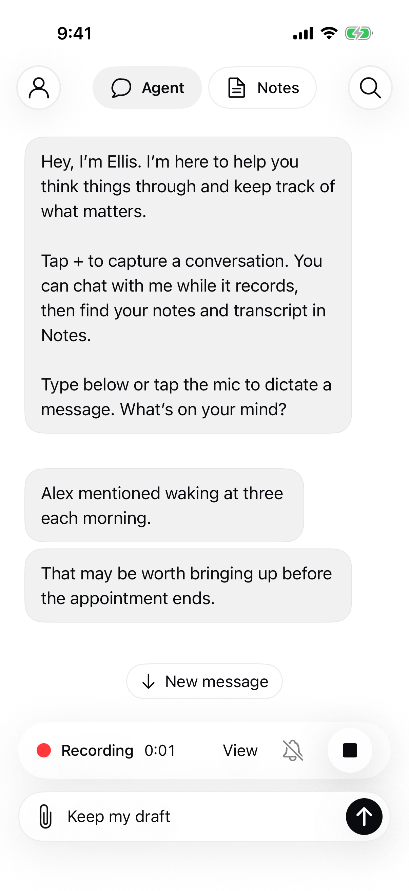

# Proactive message readability — September 28, 2026

Verified local native rendering only; not deployed. The v3 candidate prompt is prepared but **not selected or live-model validated**. Runtime still uses v2.

Founder feedback: the Cedar reminder was useful and naturally timed, but should arrive as absorbable pieces without losing details such as “before adding features.” One idea per bubble, often a sentence or two and roughly 2–4 mobile lines, is a design hypothesis rather than a hard size limit. Keep regular body text, necessary qualifiers and all useful content. No new word or bubble-count cutoff.

Explicit blank-line paragraphs in a proactive answer render as closely spaced ordinary Agent bubbles. Normal replies remain unchanged. Storage, one turn ID, cooldown and new-message behavior remain unchanged. Each bubble supports native Copy. No punctuation guessing or artificial delivery delay.

## Verification

- `xcodegen generate` passed.
- `xcodebuild -project VoiceCompanion.xcodeproj -scheme Mac -destination platform=macOS -derivedDataPath /tmp/proactive-core-build CODE_SIGN_IDENTITY=- -only-testing:CoreTests/CompanionMessageTextTests test` passed, including paragraph order, qualifiers, abbreviation preservation, normal replies and four-bubble content retention.
- Start `python3 Backend/companion_fixture.py /tmp/proactive-short-ui --ui --proactive`; supply generated config as `TEST_RUNNER_VOICE_MEMORY_UI_CONFIG` to `xcodebuild -project VoiceCompanion.xcodeproj -scheme Phone -destination 'platform=iOS Simulator,id=C804A6C5-EC44-4271-8E83-A224EB2D9234' -derivedDataPath /tmp/proactive-phone-build CODE_SIGNING_ALLOWED=NO -only-testing:PhoneUITests/ProactiveUITests test`.
- Actual native simulator UI test passed: synthetic capture over local socket, two paragraphs delivered as two ordered bubbles, draft retained, Quiet does not stop capture, Stop and relaunch preserve both paragraphs. No paid provider call or physical microphone claim. An initial incorrect `PhoneTests` target was corrected to `PhoneUITests` before successful execution.
- Screenshot inspected: readable two-line bubbles, close six-point grouping, no overlap with composer/recording controls. The later removal of the provisional three-bubble cap was covered by the core test; the screenshot’s two-bubble path is unchanged.

## Remaining gates

Candidate wording needs bounded real Luna QA for completeness, appropriate silence and natural boundaries, followed by separate deployment/native installation. Simulator output proves rendering, not generated wording quality, optimal engagement, physical feel or accessibility across every Dynamic Type setting. No new provider allowance has been consumed.

## Authorized wording screen — incomplete

Founder authorized reusing the five remaining Cedar calls without increasing budget. Five fictional requests and rubrics were prepared before invocation in `Backend/fixtures/proactive/readability-evaluation/requests.json` and `cases.json`: Cedar prerequisite, qualified multi-part plan, changed preference, unknown subject, and resolved commitment.

All five slots were atomically reserved in the existing Cedar ledger to prevent concurrent phone activity overspending. **Only two requests were sent**: Cedar completed in 1.77 seconds; qualified-plan returned `HTTPError`. The batch stopped without retry. The initial runner retained only the exception class, not HTTP status/body, so the provider cause is unknown. Diagnostic status capture was corrected locally afterward, but no failed call was repeated. Three never-sent calls remain reserved, not spent or available to automatic phone traffic; no additional budget was created. The $0.10 reservation is a conservative hold, not an invoice or five successful calls. Prior pilot usage remains intact.

Cedar output:

> The Cedar team agreed to test the basic recording flow with five people before adding features, and those tests had not happened yet. Calendar integration was meant to wait until afterward.

Manual review: key content and prerequisite preserved, but **grouping failed**—one paragraph with no blank-line message boundary. Past tense preserves historical framing but explicit “as of that note” would be clearer. Do not select v3 on this evidence. No conclusion about the two planned silence cases is possible because they were never sent.

The exact successful request/response replays through retrieval, validation, durable main-chat storage and reopen with `PYTHONPATH=Backend python3 -m unittest Backend.test_proactive_readability -v` (one test passed). That test explicitly records the single-paragraph output, not a presentation success. Existing UI grouping remains locally verified by PR129. Runtime v2 and the physical phone are unchanged.

Next: improve the candidate’s message-boundary instruction and resolve provider error observability before any further provider execution. Retain this failed candidate and predeclared cases; never present this partial screen as a passed wording checkpoint. Request shape was checked against [official Structured Outputs documentation](https://developers.openai.com/api/docs/guides/structured-outputs); schema validity alone does not establish content or presentation quality.

## Founder correction: preserve bubble UI

Message size refers to character amount. Reverted the PR129 native grouping implementation and its fixture/test changes to the verified pre-experiment baseline (`6c5330f`). The earlier screenshot and grouping assessment remain historical evidence, not the desired UI. Runtime v2 remains unchanged; candidate v3 and recorded requests remain archived evidence. No prompt selection, deployment or provider run is part of this correction.

Restoration QA: native PhoneUITests/ProactiveUITests passed on the same iPhone simulator with the restored local socket fixture. Inspected the screenshot: original single reply bubble and normal controls, draft preserved, Quiet does not stop recording, answer retained after relaunch. Initial fixture launch lacked its temporary directory; created it and reran successfully. No provider traffic.

## Character-length refinement: v4

The corrected candidate starts from v2 with an explicit soft 120–240-character drafting guide; this is a hypothesis, not a measured optimum. Necessary qualifiers, quantities and prerequisites take priority. It does not truncate or manufacture extra messages. Native App/, UnitTests/, UITests/ and project.yml are byte-identical to origin/main after the restoration: no phone installation or UI change.

Used only the three previously never-sent reserved cases with v4. An atomic transition from reserved to sending prevents a transport attempt being resumed after a crash. The operator receipt preserves each previous request hash and replacement hash. The failed qualified-plan request was not retried; no funding/cap increase. All three completed: changed preference contributed, unknown subject and resolved commitment stayed silent. All content is fictional.

Exact useful output (135 characters, correcting the initial progress estimate of 131):

> Alex previously changed their preference: 8 a.m. is best, and 11 a.m. no longer works. That may help settle the recurring meeting time.

Manual review: preserves corrected preferred time and rejected time, uses plain language, and does not invent identity or status. No added question or padding to hit a minimum. Two silence decisions are correct. One useful short example does not establish optimal engagement or completeness for longer contributions. Earlier provider error cause remains unknown; later distinct calls succeeded with improved diagnostics.

Selected v4 locally after this bounded screen. Exact request/response replay verifies current selected prompt, retrieval, validation, one saved turn and reopen for the contribution; no turns for silence. Historical v1/v2 replays explicitly pin their archived prompts; their results are not claimed as fresh v4 behavior. `PYTHONPATH=Backend python3 -m unittest discover -s Backend -p 'test_proactive*.py'` passes 42 tests (existing SQLite ResourceWarnings remain). No additional native QA required: phone UI sources unchanged and restored native behavior was already exercised above.

The original Cedar proactive ledger now has five completed calls (one physical pilot, one v3 result, three v4 results), one uncertain failed call and no remaining slots: $0.12 conservative reservations, not actual invoice cost. Hosted v2 and installed phone remain unchanged. Deployment is pending separate authorization.

## Authorized v4 internal deployment

Founder approved deploying the wording update and building conversation-level checks. Render deployment `dep-datih6093c1s73aob6ag` is live at merged PR132 `839d2c9ec274da2ee4ab986853dc56ae86e4eb73`. Backed up 28 SQLite databases with no active requests. Post-startup integrity and row comparisons across 134 tables found no changes; runtime reservations and all historical ledgers are preserved. Verified v4 prompt selection and healthy general/notes/learning endpoints. No provider calls, phone installation, UI changes or new budget. Operator receipts: ignored `work/proactive-v4-rollout/`. Rollback target is prior hosted `ce2dfec`; preserve databases and charges rather than restoring deleted data.

The exhausted test allowance is not replenished by this deployment. Wording is deployed, but additional proactive model or physical capture tests need separate bounded funding and physical readiness as applicable.
