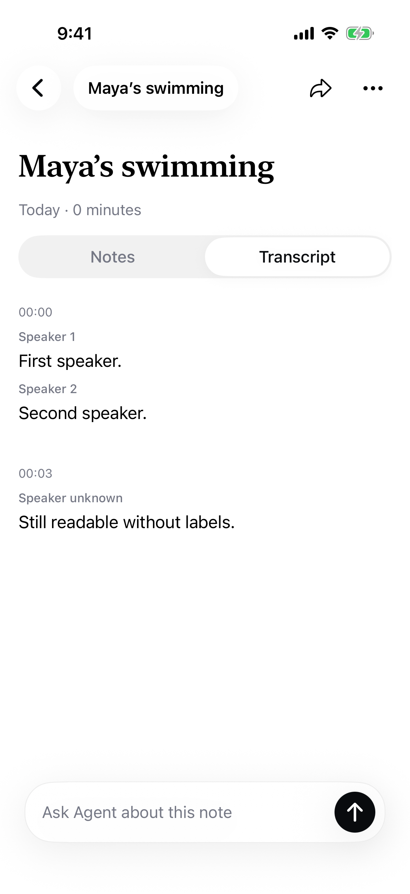

# Transcript speaker display — September 28, 2026

The companion transcript view rendered only `segment.text`, unlike the earlier native view that displayed provider word-level speaker IDs. Restore presentation of consecutive speaker turns using existing word attribution. Show Speaker 1/2/etc. for provider IDs, and Speaker unknown when missing. When all attribution is absent, preserve the complete segment text. Do not infer names or alter saved transcripts, provider settings, or memory identity.

Verification: six `CoreTests/TranscriptTests` passed via the Mac scheme, including speaker changes, mixed unknown attribution, fallback text and existing provider revision/storage regressions. `RecordingNotesPhoneUITests/testTranscriptDisplaysSpeakerChanges` passed on iPhone Simulator C804A6C5-EC44-4271-8E83-A224EB2D9234 with an isolated synthetic saved transcript and local service. Checked both speaker labels, unknown fallback, and actual rendered screenshot below. Signed iOS build passed. No paid provider calls. This verifies rendering, not real-audio attribution accuracy; the existing recording was not retranscribed.

